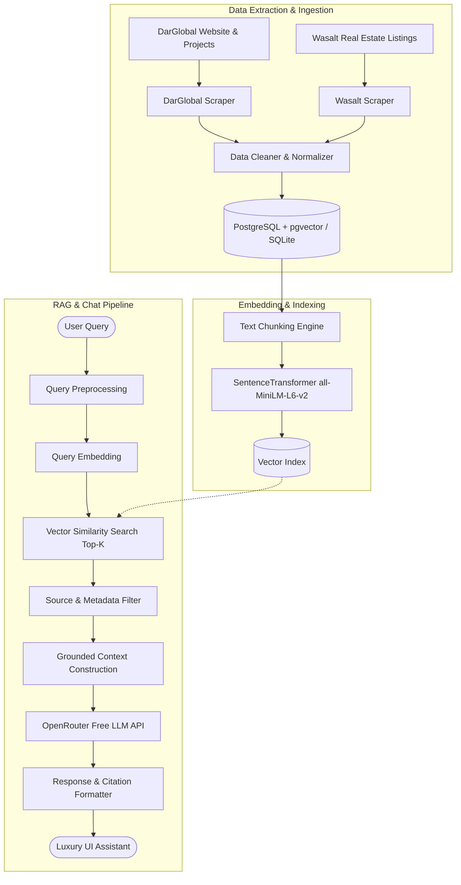

# PropIntel AI – DarGlobal & Wasalt Real Estate Intelligence Assistant

A production-grade, AI-powered real estate intelligence assistant that collects publicly available data from **DarGlobal** and **Wasalt**, indexes it with **SentenceTransformers** (`all-MiniLM-L6-v2`) and **PostgreSQL pgvector**, and answers real estate inquiries using **Retrieval-Augmented Generation (RAG)** powered by OpenRouter's free LLM.

---

## 🏛️ Architecture Overview



---

## 🛠️ Technology Stack

- **Backend**: FastAPI, Python 3.11+, Pydantic v2, SQLAlchemy 2.0
- **Vector Search & Storage**: PostgreSQL with `pgvector` (cosine similarity) / SQLite hybrid
- **Embeddings**: `sentence-transformers` with `all-MiniLM-L6-v2` (384 dimensions)
- **Web Scraping**: Playwright (JS-rendered luxury portfolios), BeautifulSoup4, HTTPX/urllib
- **LLM Integration**: OpenRouter API (`openrouter/free` or configurable models)
- **Frontend**: React 18, TypeScript, Vite, Tailwind CSS, Lucide icons
- **Containerization**: Docker, Docker Compose (multi-stage build)

---

## ⚡ Quick Start: Running the Backend & Frontend

### 1. Local Python & Vite Setup

```bash
# 1. Clone repository
git clone <repo-url>
cd "PropIntel AI"

# 2. Install backend dependencies
pip install -r backend/requirements.txt

# 3. Copy environment configuration
cp .env.example .env

# 4. Start backend (FastAPI + RAG Engine)
uvicorn backend.app.main:app --reload --port 8000

# 5. In a separate terminal, start frontend (Vite dev server)
cd frontend
npm install
npm run dev
```

Visit:
- **Web Application UI**: `http://localhost:5173` (or `http://localhost:8000` when built)
- **Interactive API Documentation (Swagger)**: `http://localhost:8000/docs`
- **Health Check Endpoint**: `http://localhost:8000/health`

---

## 🧪 Backend Test Suite Commands

Run the automated test suites in your terminal using the following commands:

### Run All Backend Tests
```bash
python -m pytest backend/tests/ -v
```
*(Or use the runner script)*:
```bash
python backend/run_tests.py
```

### Run Specific Test Modules

1. **Data Cleaning, Normalization & Duplicate Detection**:
   ```bash
   python -m pytest backend/tests/test_cleaning.py -v
   ```

2. **Embeddings & Vector Retrieval**:
   ```bash
   python -m pytest backend/tests/test_embeddings_and_retrieval.py -v
   ```

3. **RAG Pipeline & Acceptance Scenarios**:
   ```bash
   python -m pytest backend/tests/test_rag.py -v
   ```

4. **FastAPI Endpoints, Validation & Admin Security**:
   ```bash
   python -m pytest backend/tests/test_api.py -v
   ```

---

## 🐳 Docker & Docker Compose Containerization

Run the complete containerized stack (PostgreSQL with `pgvector` + FastAPI + Built React UI):

```bash
# Build and run with Docker Compose
docker compose up --build
```

The application will be available at `http://localhost:8000`.

---

## 📡 API Endpoints Reference

| Method | Endpoint | Description |
|---|---|---|
| `GET` | `/health` | Health check & model status |
| `POST` | `/api/chat` | RAG Chatbot query endpoint |
| `GET` | `/api/properties` | Filter and search Wasalt & DarGlobal properties |
| `GET` | `/api/projects` | Filter and search international luxury developments |
| `GET` | `/api/sources` | List active real estate sources |
| `GET` | `/api/admin/stats` | Pipeline records, index statistics & errors |
| `POST` | `/api/admin/scrape` | Trigger extraction pipeline (`X-Admin-Key` required) |
| `GET` | `/api/admin/scrape/status` | Status of the latest scraping job |

### Example Chat Request:
```bash
curl -X POST "http://localhost:8000/api/chat" \
  -H "Content-Type: application/json" \
  -d '{
    "message": "What projects does DarGlobal have in Dubai?",
    "source_filter": "all"
  }'
```

---

## 🌐 Production Deployment Guide

### Deploying to Render
1. Push repository to GitHub.
2. In Render Dashboard, click **New > Web Service**.
3. Select your repository and choose **Docker** runtime.
4. Set Environment Variables:
   - `OPENROUTER_API_KEY`: Your OpenRouter API key
   - `DATABASE_URL`: Connection string to your PostgreSQL database (e.g. Neon or Render Postgres)
   - `ADMIN_API_KEY`: `propintel-admin-secret-2026`
5. Click **Create Web Service**.
